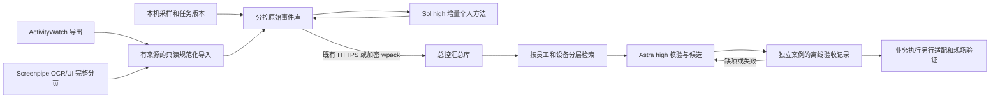

# 六项目研究与 WorkTrace 0.3 优化报告

日期：2026-10-13。研究对象是员工固定电脑上低打扰记录、个人方法学习、总控汇总与有界循环。开发电脑仅做隔离验证，不是生产总控。

## 结论与取舍

现有“本地记录服务 + 分控分析 + 总控汇总”的结构可以保留。缺少的关键环节是可互换的数据来源、受身份范围限制的记忆检索、可以保存失败和过期状态的候选评估。本次补齐这三项，没有把六套不同定位的项目同时安装到员工电脑。

| 项目 | 可直接对接或复用 | 本次借鉴并实现 | 暂缓部分及原因 |
| --- | --- | --- | --- |
| [Screenpipe](https://github.com/screenpipe/screenpipe) | 已有 OCR/UI 搜索结果 JSON，可接当前事件库 | 明确保留外部来源、分页覆盖、截断与屏幕文本的证据边界 | 没有捆绑采集器/MCP/pipes；当前为商业许可证，尚未验证真实软件覆盖 |
| [ActivityWatch](https://github.com/ActivityWatch/activitywatch) | 官方桶导出 JSON，可保留时间、应用和活动时长元数据 | 无事件 ID 的稳定身份、显式来源电脑、重复导入与冲突检查 | 不用活动时长推断绩效或流程；未分发或修改 MPL 上游源码 |
| [OpenAdapt](https://github.com/OpenAdaptAI/OpenAdapt) | 后续可单独试点演示记录/编译/运行组件 | 预先结果契约、训练与留出隔离、结果验证与模型自述分开 | 暂不接执行引擎；需要完整动作演示与真实业务软件验收，快照不能替代演示 |
| [Microsoft UFO](https://github.com/microsoft/UFO) | 后续可评估 Windows 执行器与 Galaxy 调度接口 | 有来源的经验、任务和结果分离；候选定义/适配器变化后旧验收失效 | 不替换已有 HTTPS 学习队列，也不开放任意远控；Galaxy 支持不等于本公司环境已验收 |
| [Mem0](https://github.com/mem0ai/mem0) | 后续确有语义检索需求时可单独接自建记忆库 | 按员工/设备隔离，原始证据、个人方法和候选分层，先摘要后详情 | 当前用本地有界子串检索即可；不引入嵌入服务及二次模型抽取，不沿用托管平台的效果数字 |
| [Agent S](https://github.com/simular-ai/Agent-S) | 后续可作为桌面执行适配器候选 | 规划/经验/执行的责任分离；不把经验提示模板当作岗位知识库 | 未接主模型及定位模型；S1 与当前 S3 的记忆实现不同，不能直接套用旧版能力结论 |

“直接对接”在本版指解析上游已有导出，新增第三方运行依赖为零。本次没有复制六个项目的源码，未安装或启动其程序。固定提交、真实字段和许可核对分别见 [采集研究](research-capture.md)、[执行研究](research-execution.md)、[记忆研究](research-memory.md)。

## 优化后的数据路径

模型角色、夜间预算、现有消息和补证队列保持原设计。检索和导入不调用模型；相关内容先筛选再提供给 Codex。没有做 token 成本基准测试，不承诺固定比例节省。

## 已实现的行为

1. **外部来源适配**：ActivityWatch 桶对象、Screenpipe OCR/UI 完整分页；显式电脑来源、发生时间、内容摘要与来源 ID；只接受已登记的本分控身份。16 MiB/10,000 条/31 天上限，先 dry_run，再导入。不同内容同身份整批拒绝，重导入幂等，写入正常本地同步流，HTTPS 和 wpack 保留来源。不会打开导出中的路径或 URL。
2. **分层记忆检索**：MCP 与本机 API 均要求员工、设备、日期。默认方法/候选短摘要，原始摘要显式选择，详情按单条读取。中文子串搜索有扫描窗、游标与输出预算；不是全库语义检索。模型旧结论保留原声明但呈现为待核验，范围外引用只计缺口。
3. **候选修订与评估**：总控通过正式接口登记 skill_md/loop 修订，保存旧/新定义、理由和幂等历史，预期摘要防止覆盖并发修改；新版本回到待评估。验收绑定候选内容摘要、独立任务/案件/事件、预登记人工参考、AI 输出和后续反馈。正常、缺输入、反例需齐全；由程序算文本契约结果。新失败覆盖旧通过，新稿件或新反馈让旧通过显示 stale。通过只叫 offline_evidence_passed，候选仍 draft。旧修订或旧成功回执重试不会回滚当前版本/状态。
4. **技能与发布同步**：总控和分控说明包含实际调用路径、来源限制、游标、参考契约与迁移方法；总控技能的随包引擎按清单重新生成，源文件与镜像一起验证。

具体操作见分控技能的 [外部导入](../skills/worktrace-collector/references/external-records.md)、总控的 [知识检索](../skills/worktrace-hub/references/knowledge.md) 和 [候选验收](../skills/worktrace-hub/references/candidate.md)。

## 验证与实际边界

本次验证结果记录在 [v0.3 验证记录](validation-v0.3.md)。所有数据库与输入均为合成内容；实际运行本机 HTTP、HTTPS 同步和 MCP stdio，并校验持久化结果。上游解析测试依据固定官方接口形状，不等于用真实上游 Windows 实例完成了联调。

尚未验证的部分：真实化工员工证据覆盖、方法提炼业务质量、跨电脑网络与休眠行为、实际案件系统提交效果。独立参考的 human/user_confirmed 是记录声明，不是独立身份认证；精确文本契约不能评估开放式专利撰写质量。候选、修订和评估表属于总控本地库，当前 wpack 不携带这些表，迁移总控要备份完整 data。

本版仍没有无总控的首次离线建档、总控未来身份接管和完整岗位自主执行。原化工离线部署指令继续明确这些是目标电脑需要先补齐并验证的部分。源代码优化完成，不代表这些现场环节已完成。

## 升级顺序

1. 先在独立测试目录取得 v0.3.0 专用源码包并核验 SHA256；旧版本保持不变。
2. 备份正式运行目录的完整 data，停止自己管理的服务；按原部署路径及角色安排服务升级，不能只更新已安装 Skill。
3. 涉及外部事件的总控和分控都升级后再导入。原生事件继续 1.0，外部事件使用 1.1；旧端会拒收而不会静默丢字段。
4. 先导入已结束时间段的小样本，核对身份、重复导入、同步回执和检索；再扩到一天。
5. 用一项窄流程准备未参与提炼的正常/缺输入/反例。业务执行器和真实效果验收完成前，继续只产草稿。
